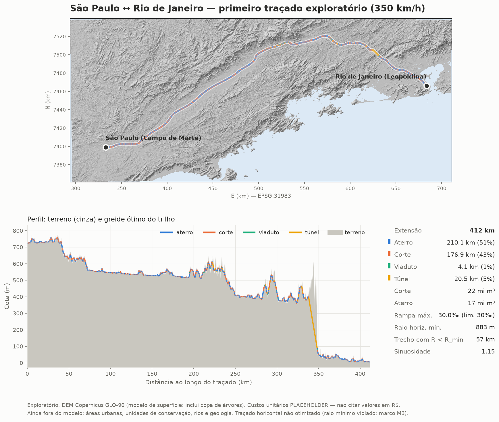
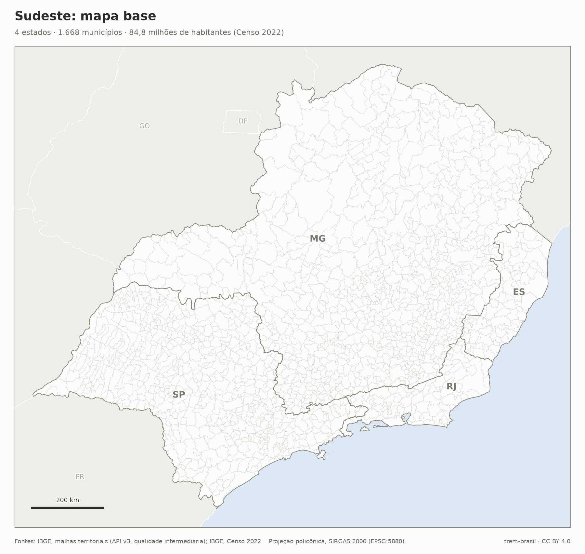
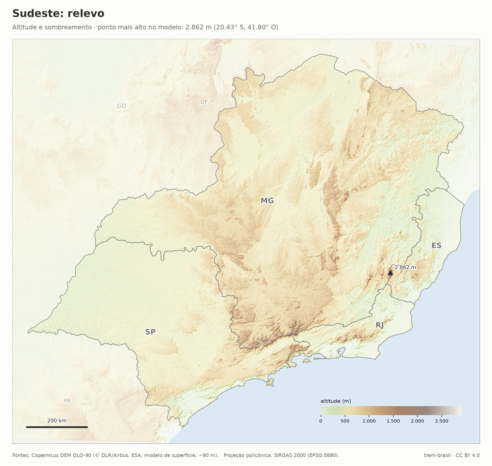
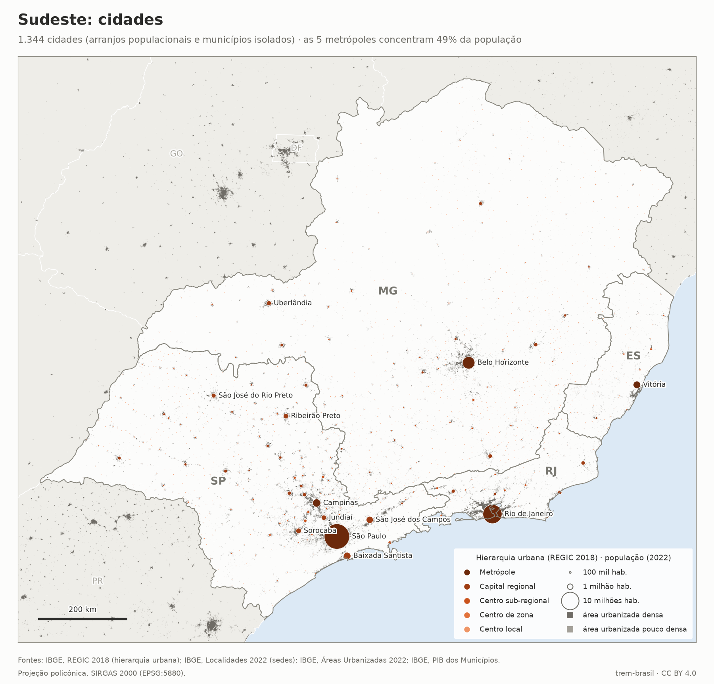
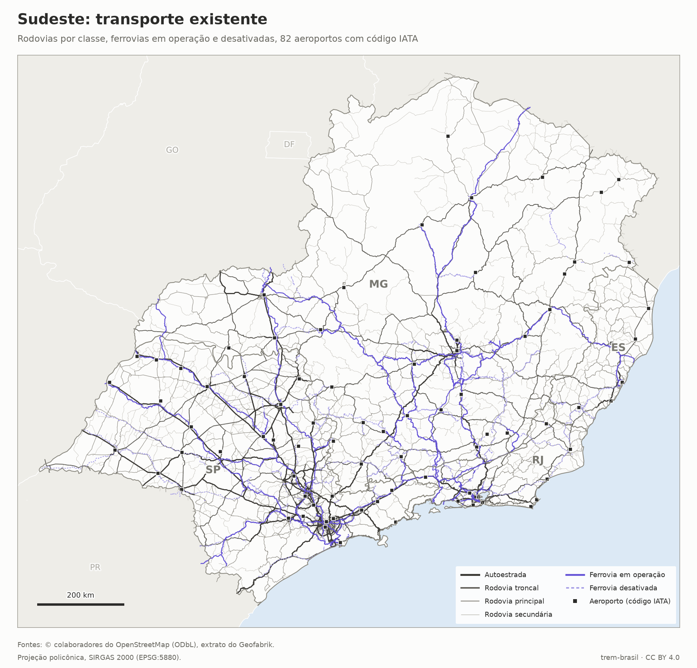
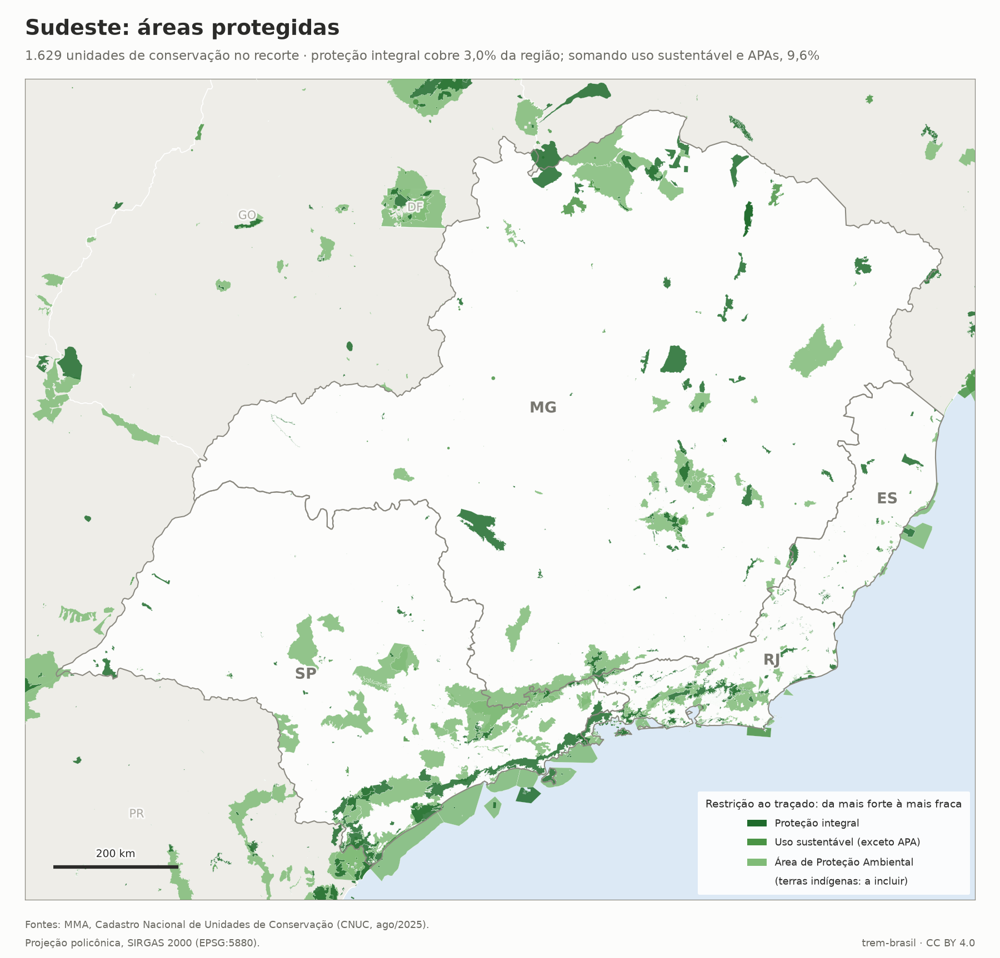

<p align="center">
  
</p>

<h1 align="center">trem-brasil</h1>

<p align="center">
  <b>Estudo científico aberto de uma malha ferroviária de alta velocidade para o Brasil.</b><br>
  Dados abertos, premissas explícitas e código reprodutível.
</p>

<p align="center">
  <a href="LICENSE"></a>
  <a href="LICENSE-CC-BY-4.0.txt"></a>
  
  <a href="https://pixi.sh"></a>
  
</p>

> **A pergunta:** com um orçamento dado, qual malha de trem de alta velocidade traz mais
> benefício ao país, por onde exatamente ela deve passar e quanto custa?

## Primeiro resultado: São Paulo ↔ Rio de Janeiro, só com o relevo



Sem receber nenhuma indicação de caminho, o otimizador encontrou o **Vale do Paraíba**, o mesmo
corredor da Dutra e da antiga Central do Brasil, e desceu a **Serra das Araras em túnel**, na
rampa máxima de 30‰.

| | |
|---|---|
| Extensão | 412 km (357 km em linha reta) |
| Estruturas | 51% aterro · 43% corte · 5% túnel · 1% viaduto |
| Tempo de cálculo | 10 a 15 s |

É um ponto de partida, não um projeto. As curvas ainda são fechadas demais para 350 km/h, o
relevo usado é de superfície (inclui a copa das árvores), cidades e rios ainda não entram e os
custos são placeholder. Cada uma dessas lacunas é um passo do roteiro.

## O plano

```
Fase 0  BASE       ambiente, testes, motor de corredor e greide                          ✅
Fase 1  DADOS      o atlas do Brasil: relevo, cidades, população, transporte, rios...    ← agora
Fase 2  RIO–SP     a mesma linha, ganhando uma camada de realismo por vez (v1 → v7)
Fase 3  MALHA      demanda entre cidades + projeto da rede nacional com orçamento
Fase 4  AVALIAÇÃO  custo-benefício, incerteza e publicação
```

A linha Rio–SP é o laboratório. A cada versão entra um ingrediente novo, e comparamos com a
anterior para ver o que ele muda no traçado:

| Versão | O que entra | Estado |
|---|---|---|
| v1 | só relevo | ✅ |
| v2 | cidades: o otimizador escolhe por onde passar, pesando gente atendida contra o custo do desvio | próximo |
| v3 | obstáculos: áreas urbanas, rios, unidades de conservação, terras indígenas | |
| v4 | terreno nu (ANADEM 30 m, sem árvores) | |
| v5 | geometria de 350 km/h (curvas com raio ≥ 7 km) | |
| v6 | custos calibrados com obras reais | |
| v7 | tempo de viagem, comparado com avião, ônibus e carro | |

Fontes, critérios de validação e detalhes de cada passo: **[docs/roteiro.md](docs/roteiro.md)**.

## Atlas do Sudeste

A Fase 1 começa pelo Sudeste. Cada camada de dados vira uma figura e entra no mapa interativo,
que mostra tudo junto, com zoom e camadas que ligam e desligam (`pixi run atlas`).

<table>
<tr>
<td align="center" width="33%"><a href="docs/img/atlas/01_base.png"></a><br><sub><b>1 · Mapa base</b><br>4 estados, 1.668 municípios, 84,8 milhões de habitantes</sub></td>
<td align="center" width="33%"><a href="docs/img/atlas/02_relevo.png"></a><br><sub><b>2 · Relevo</b><br>Copernicus 90 m; o ponto mais alto cai no Pico da Bandeira</sub></td>
<td align="center" width="33%"><a href="docs/img/atlas/03_cidades.png"></a><br><sub><b>3 · Cidades</b><br>1.344 cidades do REGIC; as 5 metrópoles têm 49% da população</sub></td>
</tr>
<tr>
<td align="center" width="33%"><a href="docs/img/atlas/04_transporte.png"></a><br><sub><b>4 · Transporte existente</b><br>rodovias, ferrovias em operação e desativadas, 82 aeroportos</sub></td>
<td align="center" width="33%"><a href="docs/img/atlas/05_protegidas.png"></a><br><sub><b>5 · Áreas protegidas</b><br>proteção integral cobre 3% da região, e a Serra do Mar é quase contínua</sub></td>
</tr>
</table>

## Como funciona

O modelo é hierárquico: cada camada resolve um problema bem definido e alimenta a de cima.

```
 0  DADOS      fontes abertas → raw (+proveniência) → processed      src/trembr/fontes
 1  DEMANDA    gravitacional PPML + logit modal                       src/trembr/demanda      (Fase 3)
 2  CORREDOR   superfície de custo + A* em 16 direções                src/trembr/terreno, tracado/corredor
 3  TRAÇADO    greide ótimo (programação dinâmica) + geometria        src/trembr/tracado
 4  REDE       MILP de projeto de rede com orçamento por fase         src/trembr/rede         (Fase 3)
 5  AVALIAÇÃO  marcha, custo-benefício, Monte Carlo + Sobol           src/trembr/operacao, avaliacao
```

Equações, hipóteses e limitações conhecidas: **[docs/metodologia.md](docs/metodologia.md)**.

**Regras de rigor**

- Toda premissa numérica fica num YAML em `config/`, com a fonte ao lado.
- Todo otimizador é testado contra uma referência independente: o greide contra força bruta,
  o corredor contra o scikit-image.
- Todo arquivo baixado ganha um registro de proveniência (URL, data, licença, SHA-256).
- O ambiente é travado (`pixi.lock`): qualquer pessoa reproduz os mesmos números.
- Custo marcado como placeholder não é citado.

## Como rodar

Pré-requisito: [pixi](https://pixi.sh). Ele instala Python, GDAL e os solvers iguais no Windows
e no Linux.

```bash
pixi install                    # cria o ambiente (≈ 3,5 GB, uma vez)
pixi run test                   # testes
pixi run trembr --help          # linha de comando
pixi run trembr dados catalogo  # as fontes de dados e o status de cada uma
pixi run dados-base             # mapa base do IBGE: país, UFs, municípios, Censo 2022
pixi run trembr dados relevo     # relevo da região (Copernicus 90 m, ~0,5 GB)
pixi run trembr dados cidades    # sedes, PIB, REGIC 2018, áreas urbanizadas 2022
pixi run trembr dados transporte # rodovias, ferrovias, aeroportos (OSM, ~0,9 GB)
pixi run trembr dados protegidas # unidades de conservação (CNUC) e terras indígenas
pixi run atlas                  # atlas: figuras + mapa interativo → resultados/atlas/sudeste
pixi run estudo-sp-rj           # corredor + greide SP–RJ → resultados/sp_rj_as350
pixi run -e nb lab              # JupyterLab, com lonboard para mapas grandes
```

Outra norma de projeto, por exemplo intercidades a 200 km/h:
`pixi run trembr estudo sp-rj --norma ic200`.

**Dados e disco.** Os modelos de relevo são lidos por streaming (Cloud-Optimized GeoTIFF): só a
janela necessária é baixada. Para o estudo nacional em 30 m, aponte os dados para um disco
externo:

```powershell
$env:TREMBR_DADOS = "E:\trem-brasil-dados"
```

## Estrutura

```
config/normas/      parâmetros geométricos (rampa, raios, plataforma), com fonte
config/custos/      custos unitários e limites geotécnicos (hoje: placeholder)
data/catalogo.yaml  as fontes de dados: licença, uso, status
data/raw|interim|processed   (fora do git; recriados pelo pipeline)
docs/               metodologia, roteiro, figuras
src/trembr/         pacote: fontes, terreno, tracado, demanda, rede, operacao, avaliacao, estudos
tests/              testes, incluindo otimalidade contra força bruta
resultados/         saídas dos estudos (fora do git)
```

<details>
<summary><b>Stack</b></summary>

| Para quê | Ferramenta | Por quê |
|---|---|---|
| Ambiente | **pixi** + conda-forge | GDAL, PROJ e solvers nativos iguais no Windows e no Linux; `pixi.lock` trava tudo |
| Raster | GDAL, rasterio, rioxarray, xarray/dask | leitura de COG por streaming, processamento em blocos |
| Vetor | geopandas, shapely 2, pyogrio, GeoParquet | formato colunar rápido e padrão |
| Tabelas grandes | DuckDB, Polars, PyArrow | microdados da ANAC/ANTT sem estourar 16 GB de RAM |
| Algoritmos | NumPy, SciPy, **Numba** | programação dinâmica e A* compilados (segundos, não horas) |
| Otimização | **Pyomo + HiGHS**, SCIP, pymoo | MILP de rede, MINLP, multiobjetivo |
| Estatística | statsmodels, SALib | PPML, logit, sensibilidade de Sobol |
| Qualidade | pytest + **Hypothesis**, ruff | testes de propriedade e contra força bruta |
| Config | pydantic + YAML | premissas validadas, cada número com fonte |

</details>

## Licença

- **Código:** [MIT](LICENSE).
- **Documentação, figuras e resultados:** [CC BY 4.0](LICENSE-CC-BY-4.0.txt). Pode usar à
  vontade, citando a fonte.
- **Dados de terceiros** mantêm a licença de cada fonte (ver `data/catalogo.yaml`).

<sub>O logo foi traçado pelo próprio otimizador do projeto: é o A* procurando o vale entre os
morros de um relevo sintético.</sub>
